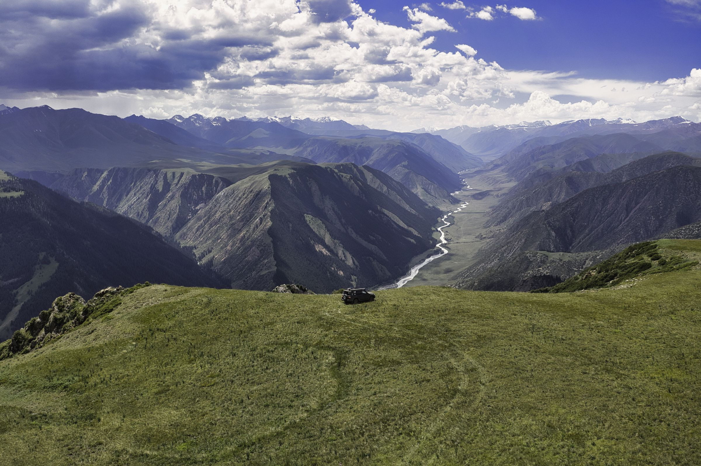

# DALA ARBA — сайт экспедиционного тур-оператора по Казахстану

**Живой сайт:** [dalaarba.com](https://dalaarba.com)



Коммерческий проект: многостраничный сайт для тур-оператора, который организует экспедиции,
авторские туры и юрточные стоянки по Казахстану. Сделан под ключ: дизайн, вёрстка,
мультиязычность, SEO, деплой и форма заявок.

> Это витринная копия фронтенда. Серверная часть (обработка заявок), скрипты деплоя
> и служебные настройки инфраструктуры клиента сюда не входят.

## Что сделано

- **~50 страниц:** направления, туры, экспедиции, «полевые заметки», юрточные стоянки, раздел о компании, юридические страницы.
- **11 языков:** RU, EN, KK, DE, FR, ES, IT, ZH, JA, KO, AR (включая RTL для арабского). Переключение на клиенте без перезагрузки страницы.
- **Без фреймворков:** чистые HTML/CSS/JS, быстрая загрузка, адаптив под мобильные, параллакс и плавные анимации при скролле.
- **Свой мини-генератор** (`build.py`): шапка, подвал и скрипты лежат в `_partials/` и подставляются во все страницы одной командой. Это единый источник правды без CMS.
- **SEO:** `sitemap.xml`, `robots.txt`, микроразметка Schema.org, канонические ссылки, редиректы.
- **Безопасность и кэш:** заголовки HSTS, `X-Frame-Options` и `nosniff`, политика кэширования статики (`_headers`).
- **Хостинг:** Cloudflare Pages (статический сайт с автодеплоем).
- **Форма заявки** (`/plan/`) отправляет данные на Cloudflare Worker, который пересылает письмо команде через Resend. Код Worker'а приватный.

## Стек

| Область | Технологии |
|---|---|
| Вёрстка | HTML5, CSS3 (custom properties, grid/flex), vanilla JS |
| Сборка | Python 3 (`build.py`) |
| i18n | Собственный переводчик на JS (`i18n.js` + `script.js`) |
| Хостинг | Cloudflare Pages, `_headers` / `_redirects` |
| Бэкенд формы | Cloudflare Workers + Resend (не публикуется) |

## Структура

```
_partials/         общие nav / footer / scripts
build.py           подставляет partials во все *.html
i18n.js            словари переводов (11 языков)
script.js          анимации, навигация, переключатель языка
styles.css         стили
about/ destinations/ journeys/ expeditions/ escapes/
field-notes/ nomadic-heritage/ yurtada/ plan/   разделы сайта
```

## Локальный запуск

```bash
python build.py              # пересобрать общие блоки
python -m http.server 8000   # открыть http://localhost:8000
```

---

Тексты, фотографии и бренд DALA ARBA принадлежат заказчику и показаны с целью портфолио.
